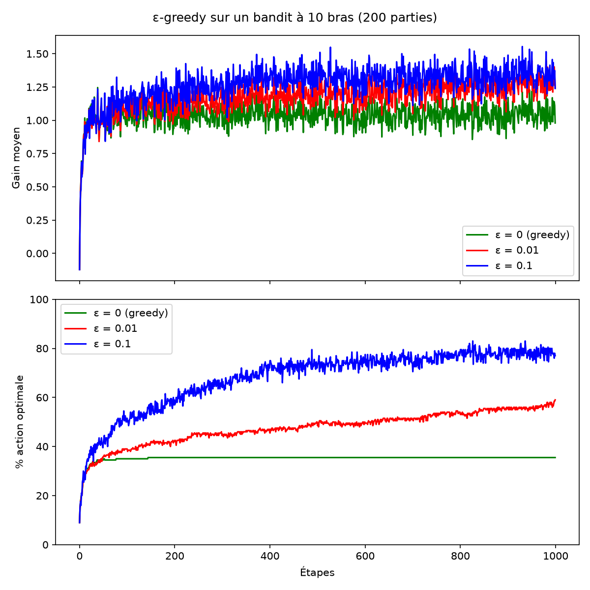
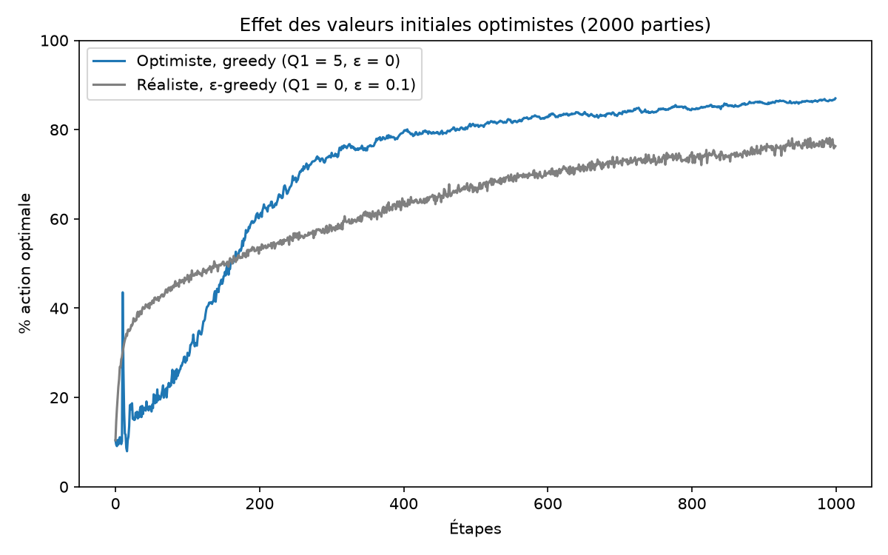
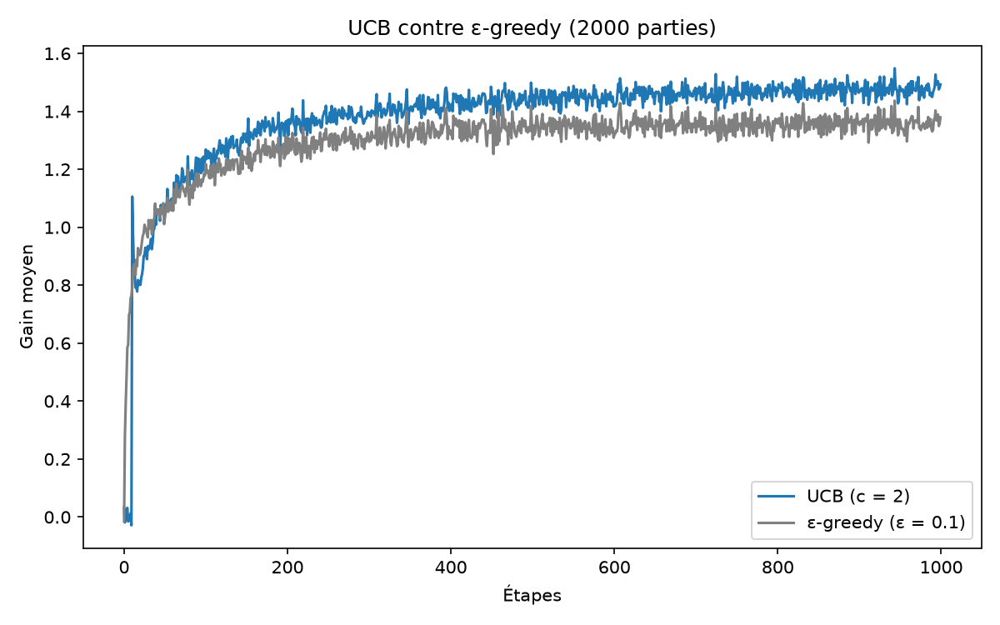
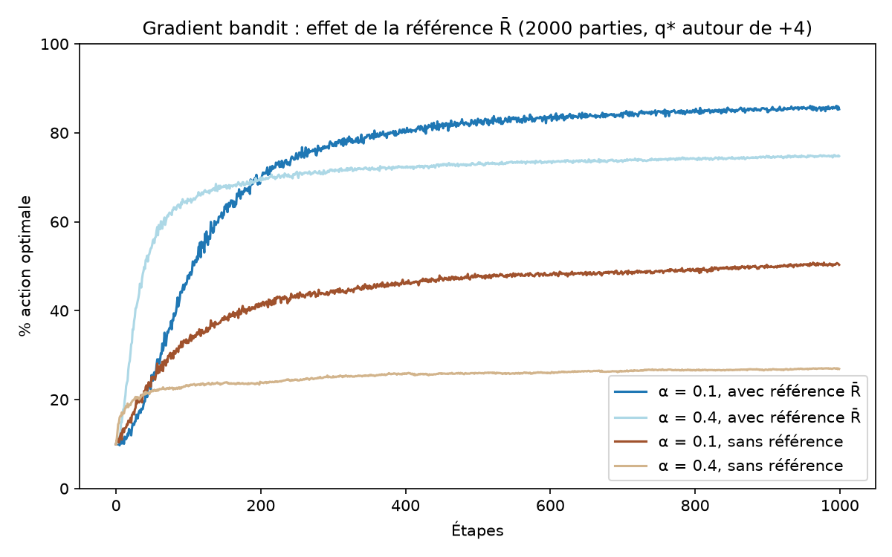
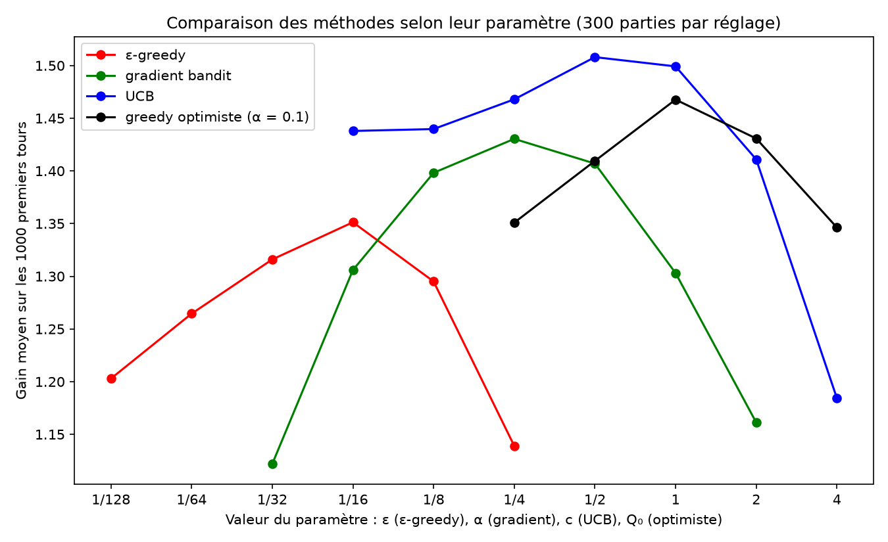
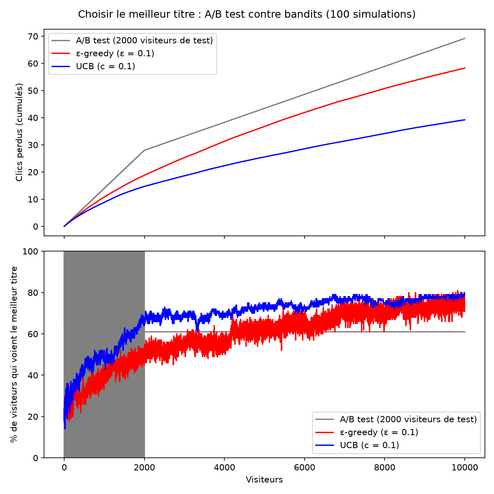

# Bandits manchots : implémentation et comparaison de stratégies d'exploration

Implémentation **from scratch** (Python, numpy) des principaux algorithmes de **bandits manchots** du Reinforcement Learning, reproduction des expériences de référence de *Sutton & Barto, Reinforcement Learning: An Introduction* (chapitre 2), et application à un cas métier : **choisir le meilleur titre d'article face à un A/B test classique**.

> 🎛️ **Démo interactive** : [lien de l'application Streamlit](https://LIEN-A-COMPLETER.streamlit.app)

---

## Le problème

Un agent fait face à **k machines à sous**. Chaque machine donne un gain aléatoire autour d'une moyenne cachée q\*(a). À chaque tour, l'agent choisit une machine et cherche à **maximiser son gain total**.

Tout l'enjeu est le **dilemme exploration / exploitation** :
- **exploiter** : jouer la machine qui semble la meilleure ;
- **explorer** : tester les autres, au cas où l'une d'elles serait meilleure.

Chaque agent maintient une estimation Q(a) de la valeur de chaque machine, mise à jour de façon incrémentale :

```
Q ← Q + α · (R − Q)      avec α = 1/n (moyenne) ou α constant (problème non stationnaire)
```

## Méthodes implémentées

| Méthode | Principe | Fichier |
|---|---|---|
| **ε-greedy** | Exploite la meilleure estimation, explore au hasard avec une probabilité ε | `agents.py` |
| **Valeurs initiales optimistes** | Greedy avec Q₀ élevé : la « déception » pousse à explorer | `agents.py` |
| **UCB** (Upper Confidence Bound) | Ajoute un bonus d'incertitude c·√(ln t / N(a)) aux machines peu jouées | `agents.py` |
| **Gradient bandit** | Apprend des préférences H(a), transformées en probabilités par un softmax | `agents.py` |
| **A/B test** (référence métier) | Phase de test à parts égales, puis on garde le gagnant | `business_case.py` |

---

## Résultats

Toutes les expériences sont reproductibles (seeds fixés). Sauf mention contraire : 10 machines, q\*(a) ~ N(0, 1), gains ~ N(q\*(a), 1), 1000 tours, moyenne sur 2000 parties.

### 1. ε-greedy : le coût de ne jamais explorer



- Le **greedy pur** (ε = 0) se bloque très tôt sur une machine sous-optimale : il ne choisit la meilleure qu'environ **35 %** du temps.
- **ε = 0,1** apprend vite et atteint environ **80 %** de choix optimaux.
- **ε = 0,01** apprend lentement mais progresse encore : à long terme, il dépassera ε = 0,1, qui reste plafonné à 91 % car il continue d'explorer 10 % du temps.

### 2. Valeurs initiales optimistes



Avec Q₀ = 5, un agent greedy (sans aucun hasard) explore toutes les machines par « déception ». Il est plus lent au début, puis dépasse ε-greedy, car il n'explore plus inutilement une fois l'apprentissage terminé. Limite : cette méthode suppose de connaître l'échelle des gains, et n'aide pas si le problème change avec le temps.

### 3. UCB : explorer là où l'incertitude est grande



UCB (c = 2) dépasse ε-greedy : au lieu d'explorer au hasard, il explore en priorité les machines qu'il connaît mal. Le pic au tour 11 correspond au moment où chaque machine a été essayée une fois.

### 4. Gradient bandit : pourquoi la référence R̄ est indispensable



Sur des machines dont les gains sont tous autour de **+4**, la version **sans référence** apprend beaucoup moins bien : chaque gain étant positif, chaque machine choisie voit sa préférence augmenter, même la pire. Avec la référence R̄ (moyenne des gains), seule une machine **meilleure que d'habitude** est renforcée.

### 5. Comparaison de toutes les méthodes



Gain moyen sur les 1000 premiers tours, en fonction du paramètre de chaque méthode (300 parties par réglage) :

| Méthode | Meilleur réglage | Gain moyen |
|---|---|---|
| UCB | c = XX | XX |
| Greedy optimiste (α = 0,1) | Q₀ = XX | XX |
| Gradient bandit | α = XX | XX |
| ε-greedy | ε = XX | XX |

- **UCB est la meilleure méthode** sur ce problème.
- Chaque méthode présente une **courbe en cloche** : un paramètre trop petit ou trop grand dégrade les résultats. Le réglage compte autant que le choix de la méthode.

---

## Cas métier : bandits contre A/B test

Un site hésite entre **5 titres** pour un article, avec des taux de clic réels (inconnus) de 4 %, 5 %, **6 %**, 3,5 % et 4,5 %. Objectif : maximiser les clics sur **10 000 visiteurs**. Le maximum théorique (afficher le meilleur titre à tout le monde) est de **600 clics**.



| Stratégie | Clics obtenus | Clics perdus | Meilleur titre affiché (fin) |
|---|---|---|---|
| A/B test (2000 visiteurs de test) | 529 | 69 | 61 % |
| ε-greedy (ε = 0,1) | 541 | 58 | 74 % |
| **UCB (c = 0,1)** | **560** | **39** | **78 %** |

*Moyennes sur 100 simulations.*

**Enseignements :**
- **UCB perd presque deux fois moins de clics que l'A/B test.** Il réduit l'exposition aux mauvais titres dès que les données le permettent, au lieu d'attendre la fin d'une phase de test.
- **L'A/B test se trompe de gagnant dans environ 4 cas sur 10** : avec 400 visiteurs par titre, une différence de 1 point de taux de clic est difficile à détecter, et l'erreur est définitive puisqu'il arrête d'apprendre.
- **Le réglage dépend de l'échelle des récompenses** : avec des gains de 0 ou 1 et des écarts de 1 à 2 points, UCB doit utiliser c = 0,1. Avec c = 1, il explore trop et devient moins bon que l'A/B test.

---

## Structure du projet

```
bandits-rl/
├── bandit_env.py         # Environnement : k machines à sous gaussiennes
├── agents.py             # ε-greedy (+ optimiste), UCB, gradient bandit
├── experiments.py        # Boucle d'expérience, moyenne sur plusieurs parties
├── plot_epsilon.py       # Expérience 1 : ε-greedy
├── plot_optimistic.py    # Expérience 2 : valeurs initiales optimistes
├── plot_ucb.py           # Expérience 3 : UCB
├── plot_gradient.py      # Expérience 4 : gradient bandit
├── plot_comparison.py    # Expérience 5 : comparaison des paramètres
├── business_case.py      # Cas métier : bandits contre A/B test
├── app.py                # Application Streamlit interactive
├── figures/              # Graphiques générés
└── requirements.txt
```

## Lancer le projet

```bash
git clone https://github.com/douaa-l/bandits-rl.git
cd bandits-rl
python -m venv .venv
.venv\Scripts\activate          # Windows  (Mac / Linux : source .venv/bin/activate)
pip install -r requirements.txt

python plot_epsilon.py          # ou n'importe quel autre script d'expérience
streamlit run app.py            # application interactive
```

## Compétences mobilisées

- Reinforcement Learning : dilemme exploration / exploitation, estimation incrémentale, UCB, montée de gradient stochastique (softmax)
- Python, numpy (calcul vectorisé), matplotlib, Streamlit
- Démarche expérimentale : simulations reproductibles, moyenne sur de nombreuses parties, étude de sensibilité aux paramètres
- Traduction d'un concept théorique en problème métier (optimisation de taux de clic)

## Référence

Richard S. Sutton & Andrew G. Barto, *Reinforcement Learning: An Introduction*, 2ᵉ édition, MIT Press, 2018 — chapitre 2.
